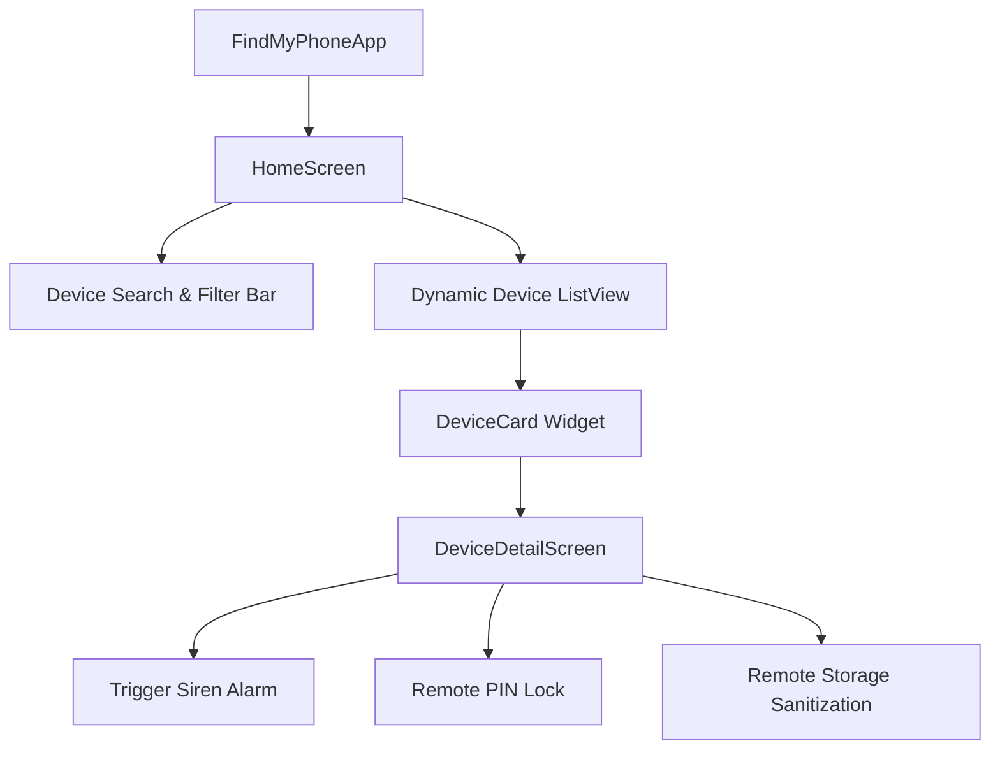

# 📱 Find My Phone - Flutter Mobile Device Tracking Application

[](https://flutter.dev)
[](https://dart.dev)
[](https://flutter.dev)
[](https://m3.material.io)
[](LICENSE)

An intuitive, production-ready cross-platform mobile application built with Flutter & Dart. It allows users to track their connected devices, view live battery levels, pinpoint real-time geolocations, and execute remote security countermeasures (Play Loud Audio, Secure Device Lock, and Remote Data Wipe).

---

## 🌟 Key Features

- **Real-Time Device Monitoring:** View status, battery percentages, and last-seen timestamps across registered phones and tablets.
- **Interactive Search & Filtering:** Instantly filter devices by name, model, or status.
- **Remote Sound Alert:** Trigger high-decibel audible alarms even when the handset is silenced or set to vibrate.
- **Remote Security Lock:** Lock the lost screen remotely with a security PIN and owner contact information.
- **Remote Wipe Directive:** Dispatch an emergency factory reset to safeguard confidential personal and enterprise data.
- **Material 3 Responsive UI:** Fluid, adaptive layout optimized for handheld phones, foldables, and tablets.

---

## 🏗️ Architecture & Component Hierarchy



---

## 📂 Project Structure

```text
Find-My-Phone/
├── lib/
│   ├── main.dart                          # Application entry point & theme initialization
│   ├── models/
│   │   └── device_model.dart              # Device entity schema & telemetry fields
│   ├── screens/
│   │   ├── home_screen.dart               # Registered device catalog with search & refresh
│   │   └── device_detail_screen.dart      # Device telemetry details & security actions
│   ├── widgets/
│   │   └── device_card.dart               # Responsive card component displaying device vitals
│   └── services/
│       └── device_service.dart            # Device data management and telemetry provider
├── pubspec.yaml                           # Flutter metadata, SDK constraints & dependencies
├── .gitignore                             # Clean Flutter build ignore rules
└── README.md                              # Project documentation
```

---

## 🚀 Getting Started

### Prerequisites
- [Flutter SDK](https://docs.flutter.dev/get-started/install) (`>= 3.0.0`)
- [Dart SDK](https://dart.dev/get-dart) (`>= 3.0.0`)
- Android Studio / Xcode / VS Code
- Android Emulator, iOS Simulator, or connected physical device

### Installation & Run

1. **Clone the repository:**
   ```bash
   git clone https://github.com/<your-username>/Find-My-Phone.git
   cd Find-My-Phone
   ```

2. **Fetch Flutter packages:**
   ```bash
   flutter pub get
   ```

3. **Verify Flutter environment:**
   ```bash
   flutter doctor
   ```

4. **Launch the application:**
   ```bash
   flutter run
   ```

---

## 🛡️ Security & Privacy Considerations

- **Encrypted Telemetry:** All location and state pings should be transmitted over TLS 1.3 with Certificate Pinning in production.
- **Authorization Guardrails:** Sensitive actions like remote device wiping require biometric re-authentication or secondary OTP validation.
- **Zero-Knowledge Architecture:** Geolocation coordinates are protected and only accessible by authorized device owner sessions.

---

## 📄 License

This project is open-source under the [MIT License](LICENSE).
